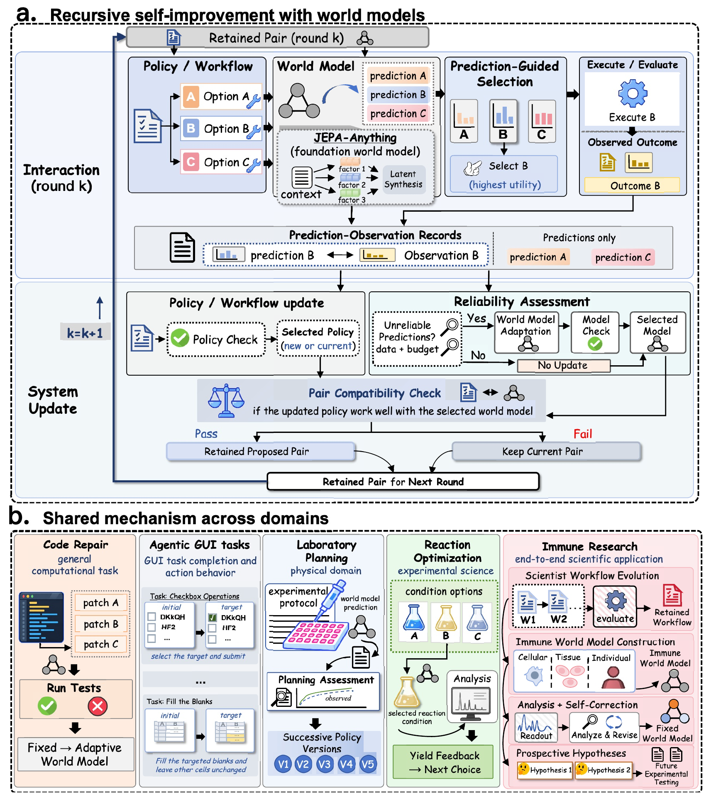
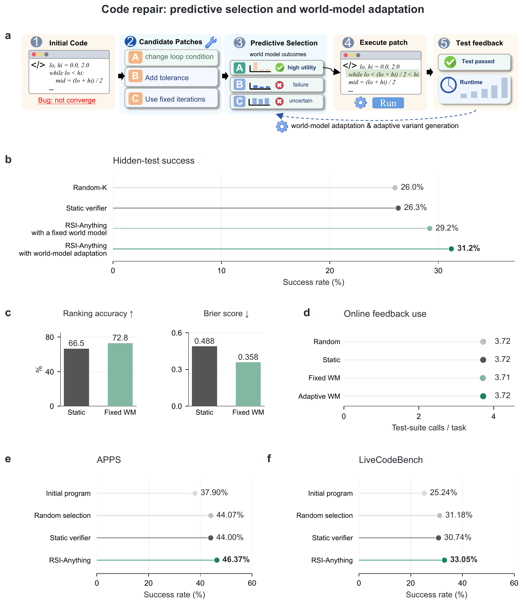
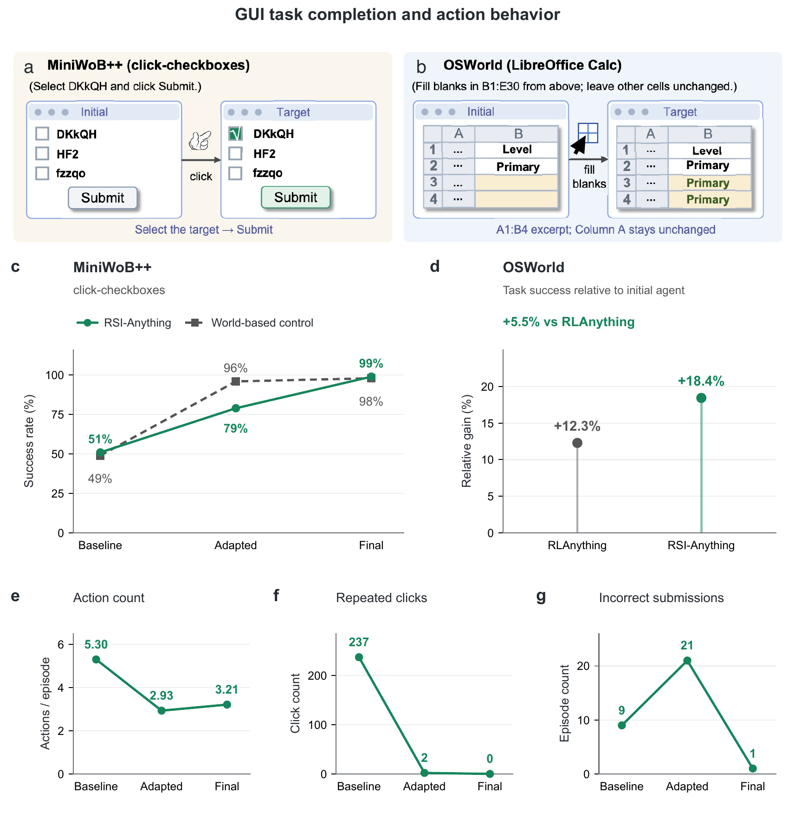
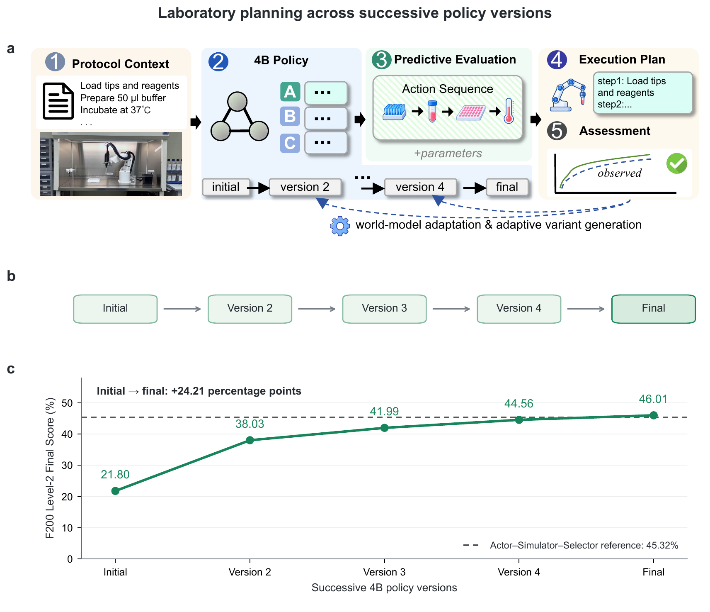
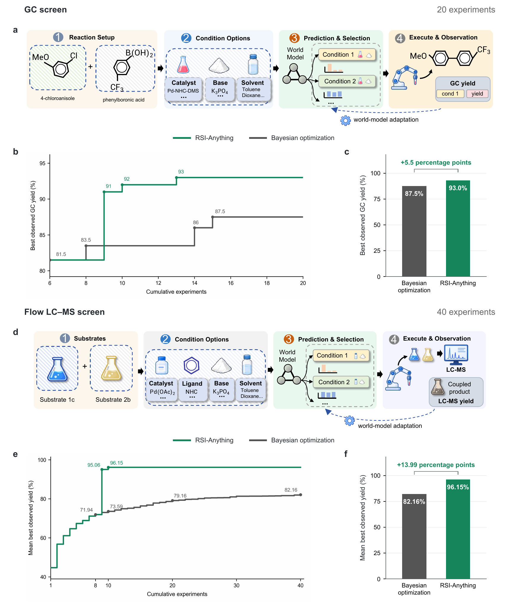
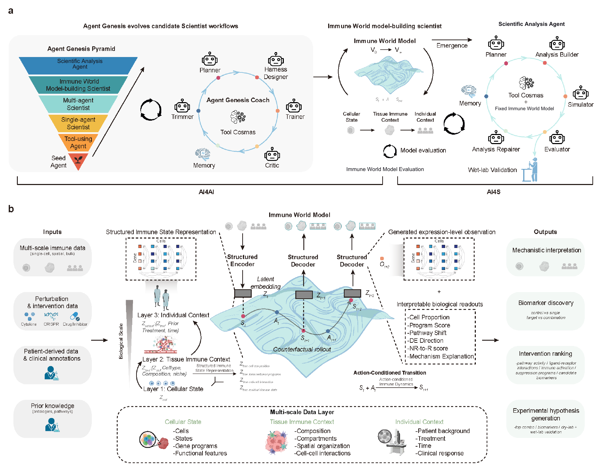

# RSI-Anything — 讲稿与学习手册

依据 arXiv:2610.13912v1；AI 辅助教学概括；未复现论文基准实验。

[原论文](https://arxiv.org/abs/2610.13912) · [作者代码仓库](https://github.com/Gen-Verse/RSI-Anything)

## 如何使用这套讲稿

精简演示讲稿用于口头讲解，展开学习讲解用于补充理解。建议的 30 分钟演示由口头讲解、三段短视频、交互活动、原图观察与转换构成；另留约 10 分钟问答。这是路线估算，不保证逐字朗读恰好达到时长，需要排练。

## 1. 这一轮，怎样让下一轮更好？

**怎样的变化，才算系统能力发生了改进？**

RSI 把经验转化为被验收、被保留、能够影响后续决策的系统变化。

### 精简演示讲稿

从调试助手开始：它失败、读取错误，再试一次。反馈很有用，但助手本身究竟学到了什么？RSI-Anything 关注经验怎样改变下一次使用的系统。两个核心组件是提出行动的策略和预测后果的世界模型。关键是验收并保留系统变化，让后续决策和学习受到影响。我们先走完闭环，再检查每组实验证据支持了哪个环节。 这一点将贯穿后面的实验解读。

### 展开学习讲解

先用熟悉的调试故事开场，追问本次尝试结束后究竟留下什么。区分错误消息、修改后的程序和修改后的助手，它们属于不同对象。本文关注负责后续决策的配置。策略可以是持久工作流，不一定只有神经网络权重；世界模型承担预测职责，也并非知道一切。交代学习路线：先理解协议，再把实验对应到实际启用的路径，最后判断证据能否建立持续相互促进的结论。单纯增加尝试次数，还不能充分证明系统本身变得更好。

### 读懂机制

先想象一个修复程序的助手：测试失败后，它阅读错误信息，再尝试一个补丁。这是在任务内部利用反馈。如果它还改好了预测器，或保存了更有效的修复流程，并在后续决策中使用验收后的版本，就发生了本文关心的持久改进。

本文把“策略与世界模型组成的系统”作为改进单位。策略负责提出或选择行动，世界模型负责预测后果。两者的配合很重要：新策略可能提出预测器不熟悉的行动，新预测器可能改变最终采用的候选。因此，组件各自变好，还需要验证组合是否好用。

研究问题很具体：外部反馈有限时，预测怎样帮助选择值得尝试的行动？观察怎样支持更新？更新后应保留哪个版本？本文给出连接预测、执行、学习与验收的流程，并在计算任务和科学领域分别检验其中的不同环节。

### 重点区别

- 观察提供经验；验收修订改变系统。
- 下一轮由保留下来的组合继续决策。
- 每项实验支撑框架中的特定环节。

### 具体例子

教学例子：保存“上次补丁失败”扩展的是任务记录；验收一个能更好排序后续补丁的预测器，改变的是系统。此例用于说明概念，不是论文中的实测运行。

### 理解检查

哪一种变化属于系统修订？

1. 追加测试日志
2. 验收用于后续选择的新预测器
3. 再尝试一个补丁

**答案: 2.** 验收预测器会改变决策系统；其他行动改变历史或任务状态。

[§1 Introduction](https://arxiv.org/html/2610.13912v1#S1)

## 2. 两只时钟：行动步骤与系统修订

**为什么多做一步行动，不等于产生一个新系统版本？**

t 记录交互步骤；k 记录更新与验收周期。

### 精简演示讲稿

这里有两只时钟：一只统计任务内部的行动，一只统计系统版本决策。可以先做几次测试，再进行更新判断；结果也可能是保留旧组合。目标和评估规则则保持固定。对代码修复来说，改程序是行动，改编码模型才是策略更新。每遇到“改进”，我们都追问：究竟改变了什么，下一步由谁负责决策？

### 展开学习讲解

画两条时间线，上面放三次行动，下面放一次更新决策。逐个询问发生变化的对象：被修好的程序属于任务状态，生成代码的模型属于策略配置。这是理解固定代码生成器实验的关键。被拒绝的版本同样消耗资源，失败实验和适配尝试并不免费。论文要求一次运行中验收规则保持固定，使比较有意义。不改变版本是合法决定；继续保留可用组合，有时比接受证据不足的修订更合理。不要把每完成一个周期说成性能一定提高，或必然产生新模型。

### 读懂机制

执行行动时，任务时钟向前一步：运行补丁、点击复选框或测量结果，都会改变任务状态或可用信息。系统判断是否提出并保留策略或预测器修订时，更新时钟推进。一个更新周期可以汇总多个行动步骤、轨迹或任务的反馈。

一次运行中，目标、接口、评分、约束、验收规则、停止规则和总预算上限保持固定；任务状态、反馈记录、剩余资源和已接受版本可以变化。区分这些对象，才能避免把改变目标或降低评估难度造成的表面进步，当成系统能力提高。

周期结束后，策略和模型可能都没变化：更新路径可能没启用，证据可能不足，候选修订也可能没通过检查。此时 k 仍会增加，因为系统完成了一次更新与验收决策。因此，周期数量不等于成功保留的修订数量。

### 重点区别

- t 与 k 统计不同事件。
- 历史增长本身不等于修订 θ 或 φ。
- 任务契约固定，已接受的系统版本可以演化。

### 具体例子

教学例子：一个周期运行三次测试，得到三条记录。随后候选预测器被拒绝，k+1 周期继续使用旧组合，但拥有更长的反馈历史。

### 理解检查

一个周期能否没有新组件版本？

1. 能，可以保留当前版本
2. 不能，k 统计成功改进
3. 只有没有行动时才可以

**答案: 1.** 周期统计更新与验收决策，也包括保留两个当前组件。

[§2.1 · Table 1](https://arxiv.org/html/2610.13912v1#S2.SS1)

## 3. 先预测，再付出反馈成本

**执行后就知道答案，为什么还要预测器？**

预测可以集中昂贵的评估机会，执行才产生观察。

### 精简演示讲稿

假设有四个补丁，却只能承担一次昂贵测试。世界模型帮助决定把机会给谁。排序有效时，同样预算可以修好更多程序。但只有被执行的补丁提供观察，未选补丁仍然未知，可靠性结论因此受到限制。还要区分外部反馈成本，与预测、适配、验收的内部计算成本。外部资源使用相近很有价值，但它是一个具体维度的比较。

### 展开学习讲解

先给全班四个补丁和一个测试名额，再引入公式，排序价值就很直观。运行所选补丁后，追问还有什么不知道，由此引出选择性观察，为第九章的三态可靠性判断做准备。区分不确定性和低效用：若明确启用了信息获取规则，不确定候选可能值得专门评估。也要区分外部交互和内部计算。后面说在线测试次数相近时，准确指出相近的是哪种资源。这支持明确的效率解释，但并未声称每项计算成本都已匹配。

### 读懂机制

系统经常能提出比实际评估能力更多的候选。生成四个补丁可能便宜，运行大规模测试却需要时间；实验室可以列出很多条件，但预算只允许少量评估。预测器提供前瞻判断，帮助安排哪些候选值得获得外部反馈。

机会与风险并存。排序准确时，同样预算可能更有效；预测错误时，系统可能反复偏爱狭窄而误导性的区域。观察主要来自被选行动，因此系统并不会自动知道被拒绝候选上的准确程度。可靠性判断必须考虑覆盖范围。

论文把外部反馈与更新计算分别讨论。测试次数相近，只能说明这一类资源使用相近，不能直接推出训练成本或实际耗时相同。严谨比较应说明匹配的资源、测量的结果，以及预测、适配、历史重评估和验收还需要多少计算。

### 重点区别

- 预测用于分配反馈，评估产生观察。
- 选择性反馈限制可靠性结论。
- 测试次数匹配，不等于总计算量匹配。

### 具体例子

教学例子：四个补丁只能测试一个。把 B 排第一可能节省评估，但执行 B 只揭示 B 的真实结果，A、C、D 仍只有预测。

### 理解检查

只测试 B 以后，哪些观察真实存在？

1. 四个都有，因为都预测过
2. 只有 B 有新的观察结果
3. 只有置信度最高的候选

**答案: 2.** 未执行候选不会凭空获得观察结果。

[§1 · §2.3–2.4](https://arxiv.org/html/2610.13912v1#S2.SS3)

## 4. 预测有用的表征

**JEPA-Anything 怎样提供预测基础？**

编码状态，预测由行动条件化的潜在目标，再读出需要的后果。

### 精简演示讲稿

把这条流水线读成编码、预测、读出。编码器概括状态，预测器回答候选行动可能带来什么，读出器给出任务需要的结果。JEPA-Anything 提供包含因素预测和合成的表征预测基础，RSI-Anything 在它周围建立改进闭环。注意接口：结果预测足以排序，但多步规划还需要推进下一规划状态的能力。 预测未来在核查前仍然只是预测。

### 展开学习讲解

用“编码—预测—读出”三个动词讲公式。z 是学习表征，不一定是可逐项解释的事实清单。行动通过领域适配器进入预测，符号描述功能角色，并不强制同一种网络连线。跨领域使用相同符号也不代表共享权重。OPF 只讲到本文明确给出的层次，更具体的架构问题指向 JEPA-Anything。最后检查接口只给出结果，还是也能给出下一规划状态；这决定能否做多步想象展开。概念图不应悄悄替所有预测器添加状态转移能力。

### 读懂机制

JEPA 式预测在表征空间中进行。编码器把状态与领域上下文变成潜在描述；预测器根据描述和候选行动，预测目标表征；读出器再把它转成可用后果，例如执行结果概率或反应产率分布。

RSI-Anything 继承 JEPA-Anything 的模型构建基础。正交预测分解把潜在目标组织为互补因素，学习专门预测器，再合成为完整潜在状态。这属于预测基础设施。本文递归机制的重点，是围绕具体领域模型，把预测与观察反馈连接到更新和验收。

点预测与概率预测是不同的输出接口。单步排序只需要结果预测，多步规划还需要能推进规划状态的适配器。因此，输出产率数值或分布的预测器，并不会自动具备逐步模拟所有中间物理状态或处理任意行动的能力。

### 公式与符号

```text
zₜ = Eφ(sₜ,c_d); ẑₜ₊₁ = Fφ(zₜ,aₜ,c_d); ôₜ₊₁ = Rφ(ẑₜ₊₁,c_d)
```

这里是公式 2–4 的点读出路径；公式 5 则返回 p(o | s,a,c)。领域实现定义效用换算及与观察的比较。

- **s_t**: 行动步骤 t 的当前任务状态
- **c_d**: 领域上下文
- **a_t**: 候选行动
- **φ**: 当前领域预测器配置
- **z / ẑ**: 编码状态／预测目标表征
- **E / F / R**: 编码器／潜在预测器／结果读出器

### 论文原图精读


开篇总览把共享的预测设计放在底层，把各领域任务与反馈闭环联系起来。这是一张概念地图，并非实验结果图。

- 先看 JEPA-Anything：继承的是跨数据类型构建潜在预测模型的设计。RSI-Anything 增加了如何使用预测、如何保留系统变化的规则。
- 再沿路径看不同领域。每个领域仍要自行定义状态、动作、预测目标、反馈与评估；共享机制不等于一个训练好的通用预测器包办所有任务。
- 沿反馈路径返回系统。观察到的结果可以改进策略或持久工作流，也可能为一次预测器适配尝试提供理由。
- 闭合箭头表示：保留下来的策略与模型组合会改变下一轮经验。仅仅存下更多观察，并不等于策略或模型发生了更新。

[Paper v1 · Figure 1 · PDF p.2](https://arxiv.org/html/2610.13912v1#S0.F1)

### 重点区别

- 潜在预测需要面向任务的读出。
- OPF 是继承的预测基础。
- 多步展开需要状态转移接口。

### 具体例子

教学类比：先概括程序状态，再预测补丁下的行为，最后读出可能的测试结果。学到的表征并不等于补丁正确性的数学保证。

### 理解检查

什么额外能力支持多步规划？

1. 更大的标量效用
2. 能推进规划状态的适配器
3. 仅有确定性读出

**答案: 2.** 只有结果输出的预测器可以排序，却未必能提供未来状态。

[§2.2 · Equations 2–6](https://arxiv.org/html/2610.13912v1#S2.SS2)

## 5. 完整闭环：从候选到保留

**反馈从哪里进入，新版本何时正式生效？**

六个操作，把当前决策与负责未来决策的系统连接起来。

### 精简演示讲稿

这是路线图：提出候选、预测后果、在预算内选择、获得反馈，再提出更新并决定保留哪个版本。注意两条边界：评估后才有观察，验收后候选更新才成为正式版本。策略和模型可以按不同节奏变化。沿返回箭头看，保留组合决定下一轮提出什么、选择什么，以及获得哪些新经验。

### 展开学习讲解

把框架图当作后五章的地图。依次指出操作，并在观察反馈与候选更新之间停一下。如果只运行 B，A 的观察在哪里？没有，因为 A 未被观察。解释异步更新：一个组件可以固定，另一个改变。组件检查与组合检查应分别显示，这里先讲作用，第十章再讲回退细节。沿返回箭头强调：验收修订改变下一次真实交互，而不只是改变对上次尝试的总结。六个操作是共用协议，各领域实验实际启用的路径可能不同。

### 读懂机制

从已接受的策略—模型组合和任务状态出发。策略提出候选，模型预测后果，有效性和操作约束剔除不可行选项。选择规则把剩余反馈预算分配给一个可行候选或候选批次。这些操作决定系统接下来获得关于什么的新证据。

执行或评估所选行动，把观察与当初用于选择的预测并排保存。反馈可用于构建策略或工作流修订，也可支持有条件的预测器适配。它们仍是候选版本，更新程序运行结束或训练损失下降，并不会让它们自动成为下一轮使用的系统。

组件检查把候选组件与当前版本比较，兼容性检查在声明条件下评估组装后的组合。通过的组合进入下一周期，被拒绝时继续保留原组合。保留修订影响后续提案、排序、反馈和学习，这种依赖闭合了递归机制。

### 论文原图精读



核心框架区分了选择动作、决定是否尝试更新，以及接受哪个系统版本。下方领域面板展示同一机制的不同具体绑定。

- 先从 a 面板的候选生成读到预测与选择。可以预测多个候选，但只有真正执行的候选能产生与其配对的外部观察。
- 把预测和观察并排记录，同时保留动作、上下文与产生预测的系统版本。缺少这种配对，就无法判断决策时使用的预测器究竟哪里出了问题。
- 更新分支中的策略与世界模型可以各自行动。模型适配需要同时满足“不可靠、有足够适配数据、预算足够”；覆盖不足是另一个状态。
- 验收是第三个决定。候选组件先通过各自检查，组装后的策略与模型还要通过兼容性检查才能保留；组合不通过则保留原组合。
- b 面板展示应用地图，并不说明每个应用都实际执行了全部更新路径；需要结合 Table 4 阅读。

[Paper v1 · Figure 2 · PDF p.4](https://arxiv.org/html/2610.13912v1#S1.F2)

[播放旁白动画](../media/videos/loop-zh.mp4) · [SRT](../media/videos/loop-zh.srt)

### 重点区别

- 行动选择和系统验收是不同决策。
- 只有被评估的候选提供成对观察。
- 更新版本通过验收前仍是候选。

### 具体例子

沿图跟踪合成补丁 B：提出→预测→选择→测试→用于提出更新→接受或拒绝。再沿返回箭头进入下一周期。

### 理解检查

候选预测器何时成为保留版本？

1. 训练完成时
2. 版本更新时
3. 通过适用的组件和组合检查后

**答案: 3.** 构建更新和保留更新是不同阶段。

[§2 · Figure 2](https://arxiv.org/html/2610.13912v1#S2)

## 6. 选择行动：有用、可行、付得起

**预测后果怎样变成选择决策？**

先排除无效候选，再按声明规则排序，并检查反馈成本。

### 精简演示讲稿

选择分三问：候选是否有效，按声明规则看有多有用，是否付得起评估成本？教学得分会减去可选的不确定性惩罚，改变权重就可能改变排序；论文代码排序器则使用执行概率。还要记住，不确定不等于没有价值。信息获取规则可能专门测试不确定行动，即使它的想象轨迹并不适合进入训练。

### 展开学习讲解

演示分两遍：先剔除一个高分但无效的候选，说明约束不是软性偏好；再改变不确定性权重，现场算出一个得分。强调这只是教学实例，论文代码排序器汇总的是执行类别概率。接着问最不确定的候选为何仍可能值得真实测试：这取决于是否启用了信息获取规则。由此引出“了解一个候选”与“把它的想象轨迹拿来学习”的区别。不要暗示所有不确定性估计都经过校准，也不要说每个领域都使用惩罚项。

### 读懂机制

策略根据当前状态和目标生成候选集合。每个候选得到结果预测，或在接口支持时得到有限步展开。验证器记录有效性、效用分项、证据来源和可用的不确定性。可行性在效用排序之前检查：预测很有前景，也不能绕过无效行动或操作约束。

框架的效用排序路径把加权效用相加，再减去可选的不确定性惩罚。权重、不确定性估计器、惩罚强度、批量大小和反馈成本都由领域规定。代码实验采用具体规则：汇总执行类别概率，给四个修订排序，再选择一个执行。

选最高效用与选最有信息价值的不确定行动，目标并不相同。只有明确启用信息获取规则时，系统才可能优先评估不确定候选。想象训练数据的准入又是另一项决策：候选可能因为不确定而值得测试，却不适合直接作为未经验证的训练目标。

### 公式与符号

```text
R_d(τ̂) = Σⱼ w_d,j r_τ,j − Δ_d(τ̂); Δ_d = λ_d U(u_τ) when enabled, otherwise 0
```

无效候选先被排除。惩罚路径未启用时 Δ=0；声明的信息获取规则也可替代效用排序，框架并不强制每个领域使用此公式。

- **τ̂**: 候选预测轨迹或所支持的结果预测
- **r_τ,j**: 第 j 项效用
- **w_d,j**: 领域效用权重
- **U(u_τ)**: 指定的不确定性估计
- **λ_d / Δ_d**: 惩罚强度／可选总惩罚

[播放旁白动画](../media/videos/repair-zh.mp4) · [SRT](../media/videos/repair-zh.srt)

### 重点区别

- 有效性先于效用排序。
- 不确定性惩罚可选，由领域定义。
- 外部评估选择与训练准入用途不同。

### 具体例子

合成计算：效用 0.80、不确定性 0.50、惩罚权重 0.20，得分为 0.80−0.20×0.50=0.70。即使另一个候选得分 0.95，只要有效性未通过就被排除。这些数字演示公式 7，并非代码基准的实际排序器。

### 理解检查

候选有效性失败，但效用最高，应怎样处理？

1. 因效用最高而执行
2. 在排序前排除
3. 自动拿来训练

**答案: 2.** 有效性和操作约束先决定哪些候选可以执行。

[§2.3 · Equation 7](https://arxiv.org/html/2610.13912v1#S2.SS3)

## 7. 把预测与观察分开保存

**想象轨迹什么时候可以进入训练？**

证据来源说明从何而来，明确准入条件才决定是否足够。

### 精简演示讲稿

预测不是观察。应把它们分开保存，并关联同一行动、上下文与系统版本。E0 到 E3 说明信息来源，不会自动赋予训练资格。想象轨迹需要独立检查有效性、效用、允许证据及启用时的不确定性。不能进入训练，并不一定禁止真实评估。如果没有启用想象学习，模拟训练集就保持为空。 每段动画也都要清楚保留这个区别。

### 展开学习讲解

在屏幕上画预测、观察两列，下方标时间、来源和版本。这通常比指示函数更容易解释证据契约。介绍 E0 到 E3 后，说明来源本身不能保证正确性或训练适用性。逐项检查一条被拒绝的想象轨迹：任一因子为零，准入结果就是零。如果没启用不确定性检查，该因子按定义取一，而不是假装已经测量不确定性。论文给出通用过滤规则，并没有说所有领域都用想象轨迹训练。教学全程都应保留这种可选性。

### 读懂机制

框架区分四类来源：E0 为确定性规则检查，E1 为学习模型预测与展开，E2 为专门模拟器或更高保真计算，E3 为外部测量或实验。这些标签描述来源和预期保真度，并不保证每个 E3 测量都正确，也不意味着所有 E1 预测都可用于学习。

应用启用想象学习路径，而且声明的过滤条件全部通过时，想象轨迹才进入模拟学习集。条件包括有效性、效用阈值、启用时的不确定性检查，以及允许的证据来源。整理这些轨迹与选择真实行动是不同决定；未启用想象学习时，该数据集为空。

反馈记录应保留输入上下文、行动、原始预测、观察结果、证据来源及生成系统版本。若用真实答案覆盖预测，就会丢失评估预测误差所需的信息。把两者关联并分开保存，同一经验才能用于行动评估、可靠性判断和适当的更新。

### 公式与符号

```text
e_τ = 1[v_τ=1] × 1[R_d(τ̂)≥r_d,min] × C_dᵁ(τ̂) × 1[ℓ_τ∈E_d,train]
```

所有因子都必须通过。省略不确定性检查时 Cᵁ=1。仅在启用想象学习时，由通过的轨迹整理 D_sim。

- **e_τ**: 二值训练准入结果
- **v_τ**: 候选有效性
- **r_d^min**: 准入所需最低效用
- **C_d^U**: 可选不确定性条件
- **ℓ_τ / E_d^train**: 支持证据标签／允许的训练来源

### 重点区别

- E0–E3 描述来源，不是自动训练许可。
- 想象学习有独立准入检查。
- 保留原始预测、观察及版本标识。

### 具体例子

教学例子：一条展开通过规则且预测效用很高，但不确定性超过准入上限，因此不能进入想象训练集。若外部评估规则允许，系统仍可实际评估它。

### 理解检查

E3 来源是否自动允许进入训练？

1. 是，所有外部测量都充分
2. 否，仍需满足声明的准入和质量条件
3. 只有 E1 同意时才可以

**答案: 2.** 来源标明出处，充分性需要另行判断。

[§2.3 · Evidence and imagined training data · Equation 8](https://arxiv.org/html/2610.13912v1#S2.SS3)

## 8. 改进策略，或改进工作流程

**策略更新究竟改变什么？**

反馈必须转化为适合被更新对象的学习信号。

### 精简演示讲稿

策略更新可以改神经网络参数，也可以改持久工作流。反馈要转成适当信号，例如示范、偏好或工作流分数。策略数据与预测器适配数据优化不同对象，因此不必相同。启用更新后得到的是候选 θ′，验收还在后面。固定策略实验中，更新指示为零，即使任务状态和生成候选仍在变化。

### 展开学习讲解

用工作流例子避免把所有更新都等同于昂贵微调。追问什么配置会持续进入后续任务。随后区分两个数据集的目标：策略学习问应该偏好什么行为，预测器适配问本应预测出什么结果。同一交互可支持两者，但筛选和标签未必相同。θ′ 上的撇号表示候选，并不等于下一已接受版本。uπ=0 的固定策略是合法实现。这样能避免听众因为程序在多轮中变化，就误说代码修复实验训练了代码生成器。

### 读懂机制

θ 可以代表可训练参数，也可以代表持久的智能体工作流。策略修订改变候选生成或选择方式。更新路线可以是示范学习、根据评估结果做偏好学习，或用评估分数搜索工作流。具体启用哪条路线、允许哪些参数或配置字段变化，必须由应用声明。

用于策略改进的记录组成 D_policy，用于预测器适配的记录组成 D_adapt。两者可能不同，因为一个面向行动行为，另一个面向预测质量。只有启用想象学习且轨迹通过准入时，它们才可补充策略数据。笼统地说“反馈数据集”，容易掩盖目标差别。

策略更新尝试还需要声明的计划或触发条件、合适的证据和足够预算。没启用尝试时 θ 不变；启用时得到 θ′，它仍只是候选配置。通过组件验收和兼容性评估后，才能成为后续交互使用的保留策略。

### 公式与符号

```text
θ′ₖ₊₁ = Update(θₖ,D_policy,k,D_sim,k) if uₖπ=1; otherwise θₖ
```

尝试标志包含声明触发条件、充分证据和预算。想象数据可以为空。本式构建候选，不决定保留。

- **θ_k / θ′**: 当前／候选策略配置
- **u_k^π**: 是否启用策略更新尝试
- **D_policy,k**: 策略改进所选记录
- **D_sim,k**: 启用时通过准入的想象轨迹

### 重点区别

- 策略可以是模型参数或持久工作流。
- 策略数据和预测器数据面向不同目标。
- 候选 θ′ 与保留 θ 不同。

### 具体例子

教学例子：反馈表明“先检查失败断言，再提出补丁”更有效。把它保存为通过验证的工作流，即使不改语言模型权重，也可以修订 θ。这用于说明框架，并非代码实验的具体更新；该实验代码生成器固定。

### 理解检查

不更新神经网络权重，θ 能改变吗？

1. 可以，验收持久工作流修订即可
2. 不行，θ 永远表示网络权重
3. 可以，随便追加日志就改变 θ

**答案: 1.** 框架允许把可训练参数或持久工作流配置作为策略对象。

[§2.4 · Policy learning or workflow revision · Equation 9](https://arxiv.org/html/2610.13912v1#S2.SS4)

## 9. 证据支持时，才尝试模型适配

**为什么“证据不足”不等于“可靠”？**

适配触发要求：不可靠、适配数据充分、预算足够，三者同时满足。

### 精简演示讲稿

可靠性有三种状态。可靠表示在覆盖范围内通过声明检查；不可靠可以支持适配；证据不足说明覆盖不够，既不是可靠证明，也不激活这个触发器。适配还要有足够合适数据和预算。评估当前模型时，要用属于当前版本的预测。即使条件全部通过，适配也只是提出新预测器，能否保留仍是另一项决策。

### 展开学习讲解

演示三态判断，不要简化成红绿二选一。先设覆盖不足，即使预算充足也不启动；再设不可靠但适配数据不足；最后让三个条件同时满足。用旧预测器和修订预测器说明版本规则：旧预测可以解释历史决策，当前可靠性却需要当前版本预测。数据阈值、损失和可训练范围由应用规定，教学界面的设置必须标成合成。触发尝试也不保证提高，候选预测器后面仍需通过组件与兼容性检查。

### 读懂机制

可靠性针对当前预测器版本和相关候选范围评估。历史记录必须使用可归属于该版本的预测：要么是它当时生成的预测，要么是它对保存输入重新计算的预测。把旧版本误差直接混入当前估计，会混淆历史决策质量与当前预测器质量。

判断有三种结果：可靠、不可靠、证据不足。被选行动只能提供有限覆盖，因此一个狭窄观察子集上的小误差，不足以证明广泛可靠。覆盖不足应判为证据不足，按正式触发式不会启动适配；后续选择仍按声明规则及剩余预算进行。

只有判定不可靠、适配数据充分且预算能覆盖估计成本时，才尝试适配。应用还需规定监督目标、预测损失和可训练参数。单个产率数值提供的是结果目标，并非完整下一状态；若上游参数可训练，结果损失也可能更新它们。

### 公式与符号

```text
uₖᵂ = 1[ρₖᵂ=unreliable] × 1[D_adapt,k sufficient] × 1[B_update,k≥ĉ_adapt,k]
```

可靠性也可返回可靠或证据不足，这两种情况均令尝试标志为零。适配路径未启用时同样 uᵂ=0。

- **u_k^W**: 世界模型适配尝试指示
- **ρ_k^W**: 当前版本可靠性判断
- **D_adapt,k**: 所选适配记录
- **B_update,k**: 本次尝试可用剩余预算
- **ĉ_adapt,k**: 相同单位的适配成本估计

### 重点区别

- 当前可靠性要使用当前版本预测。
- 覆盖不足既不是可靠，也不触发适配。
- 适配须满足三个条件，结果仍待验收。

### 具体例子

合成门控：在教学规则下，不可靠、12 条可用记录、预算足够，可能允许尝试；把判断改为证据不足，就不触发。12 仅是示例，论文没有规定通用最少样本数。

### 理解检查

覆盖不足，但数据和预算看起来很多，公式 11 是否触发？

1. 是，预算充足就行
2. 否，可靠性必须判为不可靠
3. 是，证据不足就是不可靠

**答案: 2.** 证据不足是独立状态，不满足“不可靠”指示条件。

[§2.4 · Equations 10–12](https://arxiv.org/html/2610.13912v1#S2.SS4)

## 10. 组件更好，组合仍可能更差

**单独检查组件后，为什么还要检查兼容性？**

对组装后的决策系统进行验收，并明确失败时回退到哪里。

### 精简演示讲稿

组件单独变好，联合行为仍可能变差。新策略可能提出陌生行动，新模型可能把它们排错。先由组件检查决定哪些候选版本进入组合，再由组合检查与当前系统比较。组合失败时，整个旧组合继续保留；若两个组件都未变化，就不必重新比较组合。最后记住更新数据、门控数据和最终审计数据的不同作用。 验收标准应在检查结果之前声明。

### 展开学习讲解

在图上走两个案例。第一，策略组件失败、模型通过，组装成旧策略加候选模型，这个组合仍要接受兼容性检查。第二，两个组件分别通过但组合失败，公式 18 保留整个旧组合。不要发明组合失败后自动搜索所有混搭的流程。说明平均预测误差下降为何仍可能不够：如果误差恰好集中在新策略偏爱的候选上，联合表现仍会受损。最后区分训练、门控选择与留出报告，这些数据角色决定性能数字究竟能证明什么，也帮助理解反复挑选带来的偏差。

### 读懂机制

策略组件检查把声明的任务效用和约束与当前策略比较，模型组件检查把相关预测质量与当前模型比较。已尝试且通过的组件进入候选组合；未尝试或失败的组件使用旧版本。这样先明确究竟是哪一对版本要进入兼容性评估。

组合检查处理相互影响：策略可能提出陌生候选，预测器可能改变选择或学习信号。在规定且匹配的条件下，将组装系统与当前组合比较。任务条件匹配不要求生成完全相同候选；检查关注联合决策行为，以及预测器对所选策略候选范围的适用性。

组合检查失败时，整个旧组合被保留；如果两个组件都没变化，就无需重新比较组合。更新数据用于构建候选，门控数据用于挑选保留版本，指定的留出审计集用于最终报告。若门控被反复用于挑选，也更需要独立最终审计。

### 公式与符号

```text
(θₖ₊₁,φ_d,k+1) = (θ̄ₖ₊₁,φ̄_d,k+1) if G_pair=1; otherwise (θₖ,φ_d,k)
```

横线表示经过组件检查后的候选组件；只有尝试且通过各自检查的组件才进入，否则使用当前版本。公式 18 再做组合层面的决定。

- **θ_k / φ_d,k**: 当前策略／当前预测器
- **θ̄ / φ̄**: 组件验收后组装的组件
- **G_k^pair**: 兼容性验收结果
- **k+1**: 下一周期保留版本，可能不变

[播放旁白动画](../media/videos/retention-zh.mp4) · [SRT](../media/videos/retention-zh.srt)

### 重点区别

- 组件检查分别与当前版本比较。
- 兼容性检查评估组装后的组合。
- 组合失败时，保留整个旧组合。

### 具体例子

合成例子：新预测器平均误差更小，但对新策略提出的补丁排序很差。它们可能各自通过检查，却在组合检查中失败。此时保留旧组合，不是失败后临时挑一个未测试的混合组合。

### 理解检查

两个候选组件单独通过，但组合失败，保留什么？

1. 两个新组件
2. 整个旧组合
3. 随意一个新旧混合

**答案: 2.** 公式 18 在组合验收失败时回退到整个当前组合。

[§2.5 · Equations 13–18](https://arxiv.org/html/2610.13912v1#S2.SS5)

## 11. 代码修复：把代码生成器固定住

**这一比较究竟隔离了什么因素？**

共用代码生成器和候选预算，区分选择方式与预测器适配的价值。

### 精简演示讲稿

代码修复提供较受控的比较：同一个固定代码生成器提出四个修订，选择器挑一个执行。在线测试指导修复，隐藏测试测最终成功。我们比较静态验证器、固定预测器和适配预测器。注意实现细节：官方指南在记录转移上训练适配，最终评估不运行优化器更新。交互小实验解释协议，并不复现该基准训练流程。

### 展开学习讲解

先圈出固定代码生成器标签。听到修复成功率提高时，学生容易误以为代码生成器接受了训练；这里程序改变，但代码生成器固定。解释四选一执行及在线、隐藏测试分工。随后明确区分论文一般适配路径与仓库发布流程：记录转移用于训练适配检查点，最终评估不会在线优化。该细节来自官方复现指南，不是新推断的实验结论。教学实验台可以在周期内可视化一次更新，但不能说它忠实重现了基准评估中的更新时序。

### 读懂机制

策略是固定的 ReasonFlux-Coder-7B。每轮提出四个修订，只选一个执行。W1 是 3B 执行结果预测器，以 Qwen2.5-Coder-3B-Instruct、LoRA 和 JEPA-Anything 设计构建；它为候选—测试对输出五类概率，再汇总排序修订。

核心比较使用 200 道 CodeContests 任务、三个随机种子、最多三轮反馈。随机选择、容量匹配静态验证器、固定世界模型和反馈适配世界模型，共用代码生成器和候选预算。在线测试提供修复反馈，隐藏测试决定最终全通过成功率，两者用途不同。

官方仓库给出超出论文高层闭环描述的重要实现细节：复现指南说明，适配是在已记录转移上进行的四阶段训练链，最终基准评估不执行优化器更新。因此，比较固定与适配检查点，不意味着发布的最终评估会在 600 次任务—种子评估中逐次在线梯度下降。

本站修复实验台使用小型合成例子，讲解预测、反馈、条件适配和保留，不加载 ReasonFlux、W1 或基准检查点，也不是发布训练链的逐条重放。目的是揭示决策逻辑；论文研究结果放在独立证据面板中。

### 论文原图精读



代码实验固定了代码生成策略，因此适合分开理解：预测引导选择带来多少收益，进一步适配预测器又带来多少收益。

- a 面板是程序修复示意图。为便于阅读只画了三个补丁，但基准实验每轮实际提出四个修订，最多进行三轮反馈。
- 把 b 面板与 Table 2 一起读：静态验证器的隐藏测试成功率为 26.3%，固定世界模型为 29.2%，适配世界模型为 31.2%；生成器始终是 ReasonFlux-Coder-7B。
- c 面板检查“预测是否有助于决策”。静态验证器与固定世界模型比较时，排序准确率从 66.5% 升到 72.8%，Brier 分数从 0.488 降到 0.358；这里不是适配模型的诊断结果。
- d 面板检查反馈用量：每题在线测试套件调用约为 3.7 次。这说明外部测试用量相近，不能据此说总训练与推理计算量完全相同。
- e、f 面板把选择评估扩展到 APPS Introductory 与 LiveCodeBench v6。46.37% 与 33.05% 是三个种子的完整测试套件成功率均值，不能替换成公开测试通过率。

[Paper v1 · Figure 3 · PDF p.12](https://arxiv.org/html/2610.13912v1#S3.F3)

### 重点区别

- 代码生成器固定，预测器配置不同。
- 在线反馈与隐藏最终评估用途不同。
- 仓库最终评估使用固定检查点，不做优化器更新。

### 具体例子

教学例子：同一生成器把 A–D 交给两个选择器。选择不同可以说明选择器的作用；若生成器也不同，候选质量就成为另一个可能解释。

### 理解检查

核心修复比较中，哪个对象固定？

1. 被修复程序
2. ReasonFlux-Coder-7B
3. 所有世界模型检查点

**答案: 2.** 程序与反馈变化，代码生成器固定，用于比较选择和预测器设置。

[§3.1 · §6.1 · Table 4; repository reproduction guide](https://arxiv.org/html/2610.13912v1#S3.SS1)

## 12. 仔细阅读修复增益

**更好的预测，是否对应更多成功修复？**

结果显示：预测选择与预测器适配带来连续增益，在线测试使用相近。

### 精简演示讲稿

把结果读成两个连续比较：预测选择把隐藏成功率从 26.3% 提到 29.2%，预测器适配再达到 31.2%，在线测试用量相近。排序与 Brier 改善报告的是固定模型相对静态验证器。精确配对增益是 2.83 个百分点，附有区间；展示率直接相减是约 2.9。这支持选择与适配，但固定代码生成器限制了对策略—模型共同提高的推断。

### 展开学习讲解

分两步读表：先比较静态验证器与固定世界模型，再比较固定与适配世界模型。固定代码生成器和候选预算始终可见。解释隐藏成功率、排序准确率、Brier 分数分别回答什么，指出哪些系统有预测诊断。讨论不确定性时使用论文给出的配对估计和区间，不替适配增益发明区间。同一任务跨种子重复，因此论文按任务重采样做聚类推断。最后区分在线测试匹配与总计算成本。我们核对并转录结果，没有独立运行模型或重估统计。

### 读懂机制

表 2 的隐藏全通过率分别是：随机选择 26.0%、静态验证器 26.3%、固定世界模型 29.2%、适配世界模型 31.2%。每任务平均在线测试套件调用为 3.72、3.72、3.71、3.72。这里比较的是相近的外部测试用量，不是完全相同的总体计算。

固定世界模型相对静态验证器，排序准确率从 66.5% 升到 72.8%，五类 Brier 分数从 0.488 降到 0.358。排序准确率问候选次序是否正确，Brier 分数衡量概率预测误差。这些诊断把预测质量与修复成功联系起来，但它们是不同指标。

论文报告固定世界模型相对静态验证器的配对增益为 +2.83 个百分点，95% 区间为 [+0.17,+5.50]。直接减去四舍五入后的展示成功率，会得到 2.9 点；不能把这个近似差值冒充报告的精确配对估计。图 3c 没有提供适配模型的 Brier 分数。

补充评估中，JEPA-Anything 引导选择在 APPS Introductory 和 LiveCodeBench v6 上，三种子平均成功率为 46.37% 和 33.05%。它们扩展了跨编码基准的选择证据，但不能建立策略与预测器持续共同提高的结论，因为这些比较中的代码生成器仍固定。

### 公式与符号

```text
Brier = (1/N) Σᵢ₌₁ᴺ Σ_c₌₁⁵ (pᵢc − yᵢc)²
```

这是解释五类 Brier 指标的标准定义，不是论文另行编号提出的公式。越低越好，本站没有重算报告值。

- **N**: 评估预测数量
- **p_ic**: 样例 i 属于类别 c 的预测概率
- **y_ic**: 真实类别为 1，其他为 0
- **c=1…5**: 五个执行结果类别

### 重点区别

- 26.3→29.2→31.2% 支持两个连续比较。
- Brier 与排序诊断比较的是静态验证器和固定模型。
- 区分精确配对估计与四舍五入数值的相减。

### 具体例子

指标示意：五类概率与真实类别独热向量比较，得到 Brier 损失。非常自信但错误的预测，比温和不确定的错误预测受罚更重。这解释标准指标，并非重新计算论文结果。

### 理解检查

在线套件调用相近能说明什么？

1. 训练成本完全相同
2. 本比较外部测试使用相近
3. 延迟和硬件完全相同

**答案: 2.** 预测、适配和验收计算属于其他资源维度。

[§3.1 · Table 2 · §6.2](https://arxiv.org/html/2610.13912v1#S3.SS1)

## 13. GUI：成功、错误与相对增益

**动作更少，一定代表智能体更好吗？**

任务完成与错误诊断要一起读；控制器归因还需实现背景。

### 精简演示讲稿

复选框任务说明动作数不够：中间配置只有 2.93 个动作，但错误提交更多；最终配置 3.21 个动作，成功率 99%。仓库说明选中控制器跟随策略排序，因此 99% 不能单独归因于世界模型排序。OSWorld 增益是相对百分比，18.4% 相对提高意味着基线乘 1.184，不是增加 18.4 个百分点。

### 展开学习讲解

先只给动作数，让学生选择中间或最终配置，再展示错误提交，具体说明多指标评估。重复点击、错误回合和任务成功率统计的对象不同。把官方仓库控制器细节作为额外实现证据介绍：它限制归因，但并不抹去已报告表现。alpha=0 用“跟随策略排序”解释即可，无须推导内部混合规则。OSWorld 用假设初始率计算相对增益，并清楚标注为合成。不要把 +18.4% 写成 +18.4 个百分点，也不要发明绝对成功率端点。 解读任何增益前，先让学生说清参照对象。

### 读懂机制

MiniWoB++ 复选框任务中，RSI-Anything 三种配置成功率为 51%、79%、99%，平均动作为 5.30、2.93、3.21。中间配置动作最少，却有 21 个错误提交回合；初始为 9，最终为 1。因此只追求动作少，会选错权衡。

重复点击从初始 237 次降到最终 0 次。最终配置同时实现高成功率、比基线更少的动作和更少的提交错误。论文报告策略与世界模型通过交互反馈更新，也给出世界模型控制器对应的 49%、96%、98% 成功率。

官方 GUI 结果指南补充了归因限制：开发集选出的控制器 alpha=0，跟随策略排序；纯世界模型控制器则用模型数值排序相同的策略候选。因此，99% 端点不能单独隔离世界模型排序的因果贡献。框架层描述与具体选中控制器应区分。

OSWorld 报告的是相对改进：RSI-Anything 相对初始智能体 +18.4%，相对 RLAnything +5.5%；RLAnything 相对初始 +12.3%。这些是相对百分比，不是百分点。这里没有给出初始绝对成功率，因此不能只凭这些数字还原绝对端点。

### 公式与符号

```text
Relative gain = 100 × (s_method / s_reference − 1)%
```

百分点差直接减去以百分数表示的成功率，两种单位回答不同问题。

- **s_method**: 方法成功率
- **s_reference**: 参照成功率

### 论文原图精读



GUI 图同时展示两个环境与多项诊断。OSWorld 使用相对提升百分比，其单位不同于 MiniWoB++ 成功率之间的百分点差。

- a、b 面板分别示意复选框任务与电子表格任务，帮助理解动作与可观察目标状态；它们不是一个共同基准中的两张截图。
- c 面板给出 MiniWoB++ 选定控制器三个配置的成功率：51%、79%、99%。世界模型排序控制组另有 49%、96%、98% 的结果。
- e–g 要联合阅读：中间配置平均只用 2.93 个动作，却有 21 个错误提交回合；最终配置平均 3.21 个动作，错误提交仅 1 个。
- 动作减少 39.4% 比较的是基线 5.30 与最终 3.21；这是动作数量的相对降幅，不是成功率增加 39.4 个百分点。
- OSWorld 使用相对提升：相对初始智能体提高 18.4%，相对 RLAnything 提高 5.5%。图中没有给出足以把它解释成 18.4 个百分点的绝对成功率。
- 官方仓库还区分了开发集选定的策略排序与纯世界模型排序。99% 的选定控制器端点，不能当成单独隔离世界模型排序作用的消融证据。

[Paper v1 · Figure 4 · PDF p.14](https://arxiv.org/html/2610.13912v1#S3.F4)

### 重点区别

- 动作更少，也可能错误提交更多。
- 99% 选中控制器成功率不能隔离模型排序作用。
- OSWorld 增益使用相对百分比。

### 具体例子

合成单位例子：若初始成功率是 40%，相对提高 18.4% 后为 40%×1.184=47.36%，增加 7.36 个百分点。40% 只是教学设定，不是 OSWorld 基线。

### 理解检查

相对提高 18.4% 是否就是增加 18.4 个百分点？

1. 是
2. 否，它把基线乘以 1.184
3. 只有 OSWorld 是

**答案: 2.** 计算百分点差需要知道绝对基线。

[§3.2 · Figure 4 · §6.1; official GUI RESULTS.md](https://arxiv.org/html/2610.13912v1#S3.SS2)

## 14. 五个规划版本，同一基准

**实验室版本递进说明了什么？**

连续保留的策略提升了协议一致规划；物理执行需要单独评估。

### 精简演示讲稿

实验室结果在同一 200 任务规划基准上跟踪一个 4B 策略的五个版本，Final Score 从 21.80% 到 46.01%，提高 24.21 点。最终比参照高 0.69 点，但没有给出该差值区间。记住，指标结合序列与参数一致性。它支持连续规划改进，真实设备执行及持续策略—模型共同提高，还需要额外证据。 规划一致性和执行成功回答的是不同问题。

### 展开学习讲解

把五个点读成同一策略的版本，而非五种独立模型。先说明基准和指标，再引用增益。问 Final Score 测什么，还需要哪些观察才能证明物理执行。可以观察增量变小，但不能凭五个被评估点推导普遍学习规律。4B 描述规划策略，参照是包含多个组件的 Actor–Simulator–Selector，不能据此发明系统总成本倍数。最后区分 24.21 点的过程内递进与 0.69 点的外部参照比较，两者问题与证据强度不同。 解读任何增益前，先让学生说清参照对象。

### 读懂机制

LabHorizon 评估受试剂、仪器和顺序约束的实验室规划。一级衡量视觉支持的下一行动准确率；二级衡量协议一致的行动序列，Final Score 结合序列相似度与参数准确性。F200 有 200 个任务，这个分数不是物理实验成功率。

论文跟踪一次开发序列中同一 4B 策略的五个连续版本。二级分数依次为 21.80%、38.03%、41.99%、44.56%、46.01%，首尾相差 24.21 个百分点。图中横向距离是示意的开发顺序，并非实际训练时间或相同更新成本。

最终版本 46.01%，Actor–Simulator–Selector 参照为 45.32%，差 0.69 个百分点；一级准确率为 0.700 对 0.665。它们是报告的基准均值，论文没有提供证明 0.69 点达到统计显著性的区间。模型参数量本身也不能代表系统总成本。

本实验支持连续保留策略在规划上的改进，但不能单独建立策略与世界模型持续相互提高的结论。框架图包含更广的更新路径，量化曲线实际跟踪的是策略版本。真实设备的接口和失败模式，仍需要额外执行验证。

### 论文原图精读



本图在相同的 200 任务 F200 Level-2 基准上，按开发顺序比较一个 4B 策略的五个版本。评分衡量计划对齐程度，并非机器人执行成功率。

- a 面板把实验规程、候选动作序列与参数选择，接到预测评估和执行计划。虚线表示框架中可能启用的更新路径。
- b、c 面板跟踪五个保留的策略版本：21.80%、38.03%、41.99%、44.56%、46.01%，总共增加 24.21 个百分点。
- Final Score 结合动作序列相似度与参数准确度。46.01% 是基准评分，不能理解为湿实验成功完成比例。
- 45.32% 虚线是 Actor–Simulator–Selector 参考系统。最终版本高出 0.69 个百分点；比较模型大小并不意味着其他资源全部受控。
- 横轴表示开发顺序，间距只是示意，不代表每个版本耗费相同训练成本；这条上升曲线本身也没有量化世界模型与策略共同进步。

[Paper v1 · Figure 5 · PDF p.15](https://arxiv.org/html/2610.13912v1#S3.F5)

### 重点区别

- F200 Final Score 衡量规划一致性。
- 五个策略版本从 21.80% 提高到 46.01%。
- 0.69 点均值优势未附显著性区间。

### 具体例子

教学例子：计划步骤正确，却使用错误时长或试剂用量。结合序列与参数的分数可以反映两方面，但不能证明机器人已经安全、成功地执行。

### 理解检查

46.01% 描述什么？

1. 真实实验室执行成功率
2. F200 二级协议一致规划平均分
3. 世界模型校准准确率

**答案: 2.** Final Score 结合序列相似度和参数准确性。

[§3.3 · Figure 5 · Table 3](https://arxiv.org/html/2610.13912v1#S3.SS3)

## 15. 化学：在各自筛选协议内比较

**固定观察预算内，反馈引导搜索能达到什么结果？**

两个独立实测产率筛选支持预算选择；发布的流动评估是固定模型的候选池重放。

### 精简演示讲稿

化学部分有两组筛选：GC 在二十次观察后为 93.0% 对 87.5%；另一组流动筛选在四十次后为 96.15% 对 82.16%。指标都是历史最佳产率。发布的流动评估重放固定实测条件池，预测冻结，反馈改变后续选择。它支持预算下的顺序搜索，但不代表发布循环每步都开展全新实体实验或神经权重更新。

### 展开学习讲解

先把两组筛选在页面上分开，连同方法和预算一起读端点。用三个虚构产率解释历史最大值，否则单调曲线容易被误读为每一步都更好。随后说明仓库实现范围：321 个实测候选，八个初始观察计入四十次，一百次运行，预测冻结，期望改进选择依赖反馈历史。反馈能够改变决策而不改变模型权重。这避免把重放混成持续适配的实体实验室。论文通用选择契约仍有价值，但发布评估支持的是范围更窄、可准确描述的实证结论。 解读任何增益前，先让学生说清参照对象。

### 读懂机制

论文研究两个 Suzuki–Miyaura 筛选协议，在各自协议内比较 RSI-Anything 与贝叶斯优化。GC 分析的 Pd–NHC–DMS 筛选中，20 次评估后最佳已观察产率为 93.0% 对 87.5%，相差 5.5 个百分点。这是具有独立反应、选项和测量方法的一组筛选。

另一组使用 Pd(OAc)2 的流动 LC–MS 筛选中，40 次评估后的平均最佳已观察产率为 96.15% 对 82.16%，相差 13.99 点。两组不能拼成一条轨迹，也不应平均端点。“最佳已观察”是历史最大值，即使新观察变差，曲线也不会下降。

官方反应优化指南说明，发布的流动评估是在固定的 321 个已测条件池中进行顺序重放，运行 100 次；八个初始观察计入总共 40 的预算。预测保持冻结，反馈改变期望改进选择，并移除已观察候选，而非每次观察后更新神经网络权重。

这一实现细节限定了结论：它是基于实测数据、可复现的反馈引导选择实验，不能据此说发布推理循环每次选择后都会开展一个全新湿实验。更一般的物理部署和向其他化学体系迁移，需要超出已报告候选池、协议和预算的评估。

### 论文原图精读



上下两部分是两个独立的 Suzuki–Miyaura 筛选协议。每个端点只在其所属筛选内部，用相同观察次数比较方法。

- a–c 单独看作 GC 筛选：20 次观察后，RSI-Anything 的已观察最佳产率为 93.0%，贝叶斯优化为 87.5%，相差 5.5 个百分点。
- d–f 单独看作流动 LC–MS 筛选：40 次观察后，平均已观察最佳产率为 96.15% 与 82.16%，相差 13.99 个百分点。
- “至今最佳”曲线不会下降，因为它记录此前见过的最高实测产率；这并不表示每次后续实验的产率都更高。
- 化学结构和箭头解释条件选择与反馈，不足以证明每次观察都会引起神经网络权重更新。
- 官方流动筛选发布版本从 321 个条件的固定池中顺序回放实测产率，40 次预算包含初始 8 次观察。预测表保持冻结，反馈改变的是期望改进的选择。
- 这些结果支持在论文筛选池与预算内提高搜索效率，尚不能推出对任意反应的迁移能力，也不能等同于自主实验室的整体表现。

[Paper v1 · Figure 6 · PDF p.17](https://arxiv.org/html/2610.13912v1#S3.F6)

### 重点区别

- GC：20 次观察，93.0% 对 87.5%。
- 流动筛选：40 次观察，96.15% 对 82.16%。
- 发布的流动重放在实测池上使用冻结预测。

### 具体例子

教学例子：产率 40、80、55，对应历史最佳 40、80、80。末段持平不代表第三个条件达到 80，而是先前最佳仍为 80。

### 理解检查

新观察很差，历史最佳曲线为什么仍可持平？

1. 差结果被暗中提高
2. 指标保留先前观察中的最大值
3. 所有条件产率相同

**答案: 2.** 历史最大值记录见过的最佳值，而非最新产率。

[§3.4 · Figure 6 · §6.1; official reaction guide](https://arxiv.org/html/2610.13912v1#S3.SS4)

## 16. 免疫科学：构建与分析分阶段

**哪些部分发生改进，哪个预测器保持冻结？**

工作流演化构建模型；下游自我纠正分析使用固定模型参数。

### 精简演示讲稿

先区分构建与分析：工作流搜索选中并保留模型构建流程，产出免疫世界模型；随后分析智能体使用参数冻结的模型，根据证据与自我纠正修订干预和假设。最终 SIRPα 与 IL-36γ 组合是待检验的前瞻提名。它是具体产出，但证据没有建立已验证疗法，也没有说明下游分析持续重训预测器。

### 展开学习讲解

在构建与下游分析间画清晰分界。左侧由保留的模型构建工作流产出免疫预测器；右侧候选干预和假设变化，预测器冻结。逐条问箭头修改哪个对象。三种生物尺度作为输入与预测背景解释，不要暗示已经完整机制模拟所有免疫过程。治疗端点使用前瞻措辞。论文引用另一篇免疫世界模型研究提供开发与评估细节。本课总结它在 RSI-Anything 中的角色，没有独立验证模型，更不会把假设提名当作治疗建议。

### 读懂机制

构建阶段使用 Agent Genesis 搜索科学智能体工作流和模型配置，保留选中的模型构建工作流，并产出行动条件化的免疫世界模型。这里留下了持久工作流与所得预测器。要与后续分析阶段区分：后者使用构建好的模型，而非不断重新训练。

模型表示细胞状态、组织免疫上下文和个体上下文；显式行动包括细胞因子、遗传扰动或候选疗法。读出支持跨尺度预测与解释。实测扰动证据支持开发，留出干预和生物背景用于评估预测与行动组合。这些是预测评估，不直接证明治疗获益。

下游分析时，世界模型参数冻结，但分析状态、候选干预、工具使用和假设排序可以变化。分析智能体协调推理、评估与自我纠正。因此，修改假设不等于适配底层世界模型。把此应用对应到通用框架时，阶段区分非常重要。

论文报告自我纠正剔除了筛选的细胞因子对候选，整合证据后提出 SIRPα 抑制与 IL-36γ 轴调节的前瞻组合。这是供后续实验检验的具体假设。工作流端到端产出它，并不等于已经证明疗效、临床适用性或完成治疗实验。

### 论文原图精读



该应用把科学工作流演化、免疫世界模型构建和下游分析连接起来。最终治疗组合是等待实验验证的假设。

- A 面板要分阶段读：构建阶段通过工作流搜索，选择持久的模型构建工作流，再由该工作流产出免疫预测器。
- 下游分析时预测器冻结。分析状态、工具调用、干预候选和假设排序，仍可通过推理与自我纠正发生变化。
- B 面板具体解释动作条件预测：细胞、组织与个体上下文构成状态，干预是动作，模型预测其后果。
- 实测扰动数据支持模型开发，留出的干预或上下文检验预测。模型产生的生物读出与实测结果承担不同的证据角色。
- SIRPα 抑制与 IL-36γ 轴调节的组合是前瞻性提名。本框架图和论文都没有建立其临床治疗有效性。

[Paper v1 · Figure 7 · PDF p.18](https://arxiv.org/html/2610.13912v1#S3.F7)

### 重点区别

- 构建阶段保留工作流及所得模型。
- 下游预测器参数保持冻结。
- 治疗方向提名仍待实验检验。

### 具体例子

教学区分：从假设表删除证据薄弱候选，改变的是分析状态；为更准预测留出干预而更新模型权重，改变的是预测器。报告的下游分析进行前一类修订，同时固定预测器参数。

### 理解检查

下游免疫分析中什么保持固定？

1. 所有假设
2. 世界模型参数
3. 分析状态

**答案: 2.** 假设与分析可以变化，构建好的预测器参数保持冻结。

[§3.5 · Figure 7 · §6.1](https://arxiv.org/html/2610.13912v1#S3.SS5)

## 17. 一个框架，多种证据范围

**论文已经建立什么，哪些问题仍然开放？**

机制的跨领域复用，与单个任务中持续相互促进，是不同命题。

### 精简演示讲稿

证据要与实验逐项对应：代码支持选择和预测器适配，实验室支持策略递进，化学支持预算搜索。它们不会自动合成单个任务内持续相互提高的证明。作者明确要求联合多轮评估。应同时保留贡献与问题：可复用改进协议已有经验支持，而最强的长期耦合命题仍需专门检验。

### 展开学习讲解

展示更新范围矩阵，请学生逐行说出改变对象。用自己的话解释讨论中的联合评估限制，并区分“没有足够证据”与“不可能实现”。论文提供了有用机制和结果，缺少纵向联合研究是研究机会，不代表所有发现无效。强调两层限定：应用实验的经验范围，以及可靠性判断对已覆盖候选的局部范围。新策略可能走向未测区域，所以两层都重要。继续区分作者论文、仓库实现细节和本课提出的后续测试。

### 读懂机制

广泛下结论前先读表 4：代码固定代码生成器，比较选择和预测器适配；实验室跟踪策略版本；GUI 报告双组件更新，但有控制器归因限制；化学评估反馈选择，发布的流动重放冻结预测；免疫把构建与下游固定模型分析分开。

这些是共用机制的互补展示，不是每条路径的可互换证明。讨论明确指出，要建立同一任务内策略与世界模型的持续相互促进，还需要联合多轮评估。领域再多，也不会自动补上这项纵向比较，更不能证明不受限制的递归提高。

其他边界依领域而异：规划一致性需要设备执行验证，化学受已报告筛选与预算限制，治疗提名等待实验。可靠性结论还受观察候选覆盖约束。好的解读既保留边界，也承认预测选择、预测器适配、策略递进和实测反馈搜索的证据。

### 重点区别

- 领域通用性指改进流程的复用。
- 持续耦合提高需要联合多轮证据。
- 每项结论都要对应实际更新范围。

### 具体例子

证据练习：“固定代码生成器配合改进预测器提高修复成功率”在报告设置中有支持；“每个领域每轮都更新两个组件”没有；“当前可靠性检查覆盖任何未来策略”同样没有支持。

### 理解检查

哪个结论还需要联合多轮评估？

1. 预测选择能帮助报告的代码修复
2. 单一任务内策略—模型持续相互提高
3. 五个实验室版本分数递增

**答案: 2.** 论文明确指出这项纵向耦合结论需要更多证据。

[§5 Discussion · Table 4](https://arxiv.org/html/2610.13912v1#S5)

## 18. 它在已有学习方法中处于什么位置？

**它与单独的反思、规划或自训练有何不同？**

区别在于把预测选择、反馈修订和策略—模型验收保留组合起来。

### 精简演示讲稿

反思、学习和规划提供不同能力：反思改当前答案，策略学习保留行为变化，世界模型提前预测后果。RSI-Anything 用反馈记录与验收规则，把这些能力围绕策略—模型组合组织起来。贡献在于连接，而不是发明每个组件。公平比较时，问改变什么、什么证据支持改变、哪个配置进入后续决策。

### 展开学习讲解

做机制比较，不做无关方法排行榜。使用三列：改变对象、所用证据、保留产物，把任务内反思、持久策略学习、固定世界模型规划和完整协议放进去。方法之间可能重叠，不要绝对地说某类从不使用某组件。论文相关工作提供例子，本课区分依据是功能。请听众说明把规划器变成保留改进闭环还需要什么，答案应包含预测—观察记录、更新规则、版本可靠性、组件检查和组合验收。 解读任何增益前，先让学生说清参照对象。

### 读懂机制

任务内反思利用反馈修改答案或行动，可能立即有用，但不一定产生持久策略修订。自训练和偏好学习能做持久更新，却不会自动提供预测行动后果的世界模型，也不自动包含策略—预测器兼容性检查。

世界模型规划在行动前评估可能未来，提供前瞻选择能力。但固定规划系统未必根据新证据修订或保留任何组件。RSI-Anything 明确连接预测与观察、观察与候选修订，以及决定下一轮系统的验收决策。

本文建立在已有研究上，并不声称单独发明预测、验证或反馈学习。其组织重点是耦合策略—模型系统、版本感知可靠性、条件适配和考虑兼容性的保留。具体算法仍由领域决定。公平比较应问改变什么、由什么证据驱动、最终保留什么。

### 重点区别

- 反思可以改答案而不改行动系统。
- 规划可以用预测器而不适配它。
- 该协议组织这些能力间的连接与验收。

### 具体例子

比较练习：一个始终使用相同策略和模型的规划器，增加搜索深度改变的是推理；加入通过验证的新策略版本，改变的是保留系统。它们属于不同实验干预。

### 理解检查

固定规划器使用同一策略和模型搜索更深，改变什么？

1. 推理投入，不一定修订保留系统
2. 自动改变两个神经模型
3. 验收阈值必须变化

**答案: 1.** 增加推理与验收系统修订是不同干预。

[§4 Related Work · §5](https://arxiv.org/html/2610.13912v1#S4)

## 19. 设计缺少的耦合实验

**什么实验能检验持续相互促进？**

建议研究应在匹配资源和独立审计下，跨周期跟踪两个组件。

### 精简演示讲稿

下面是后续研究建议：在同一任务族，跨周期比较不更新、只更新策略、只更新模型和联合更新。既跟踪当前策略候选上的预测质量，也跟踪联合任务表现。匹配明确的资源，并计入检查成本；保护审计数据，记录被拒更新。这样才能检验耦合何时产生持续收益，而不是预设组件各自提高就必然组合成功。 这是研究设计建议，并非论文结果。

### 展开学习讲解

本章开始先声明证据状态变化：这是根据论文局限提出的研究设计。逐项解释四条路线分别控制什么混杂。联合更新可能耗费更多计算，某些问题只匹配外部观察不够，但另一些问题这样匹配仍合理，应先决定比较问题。解释门控数据反复挑选版本时，独立审计为何重要。也要记录未改变周期和被拒修订，否则漂亮的保留版本曲线可能隐藏昂贵失败。目标是识别耦合何时有帮助、哪里会失败，而不是先假定一定提高。

### 读懂机制

以下是后续研究建议，不是论文结果：选择同一任务族，运行四条受控路线——均不更新、只更新策略、只更新模型、两者都更新。固定目标、接口、候选配额、验收规则和资源定义。跨多个周期跟踪保留版本，在后续任务上评估，而非只比较首尾检查点。

再消融条件适配和兼容性保留，同时测量检查成本。记录当前模型在当前策略候选分布上的预测质量、观察覆盖、所选行动、被拒更新与资源使用。组件性能与联合决策性能都要报告。失败更新也有信息，不应从日志中消失。

更新数据构建候选，门控数据做选择，受保护的审计数据支持最终结论。估计不确定性时考虑反复选择和重复任务，明确检查新候选区域与分布变化。若匹配观察或计算后联合收益消失，这会约束机制优势，而不只是降低一个展示分数。

### 重点区别

- 本章提出测试，并未增加论文实测结果。
- 同时跟踪组件轨迹与联合行为。
- 纳入失败更新、覆盖及相关成本。

### 具体例子

建议诊断：策略在熟悉行动上提高，却进入新行动区域。将联合系统称为可靠提高前，先审计新区域的预测质量。这里不假设存在通用审计阈值。

### 理解检查

哪个设计最适合检验耦合命题？

1. 不同领域各取一个最终分
2. 受控更新路线、独立审计与联合多周期跟踪
3. 更大的框架示意图

**答案: 2.** 该命题涉及长期相互作用与持续性，设计需同时观察两者。

[Motivated by §5 Discussion; proposed study](https://arxiv.org/html/2610.13912v1#S5)

## 20. 用六个动词复述闭环

**离开框架图，你能解释机制、证据与边界吗？**

提出、预测、选择、观察、修订、保留，并说明每个判断的证据状态。

### 精简演示讲稿

用六个动词解释闭环：提出、预测、选择、观察、修订、保留。始终说清改变哪个对象、证据来自哪里。实验要准确表述：预测选择和适配预测器帮助报告的修复任务，连续策略提升规划，实测反馈搜索改善特定筛选端点。持续策略—模型相互提高仍需专门评估。最后区分论文发现、仓库细节、本站合成演示和后续研究建议。 这种证据意识也是理解方法的一部分。

### 展开学习讲解

把末章用于主动回忆，而不是再读一遍总结。先隐藏框架，让听众说出六个操作；再揭示图，指出观察在哪里产生、适配在哪里触发、候选版本在哪里被接受。只有需要修正漏掉的依赖时才重播短片。最后把陈述分类为基准结果、仓库实现、合成示例或研究建议。三十分钟包含解释、停顿、看图、互动和讨论，不是声称精简讲稿逐字朗读正好三十分钟。鼓励通过章节来源与证据审计独立核查。

### 读懂机制

口头重建一个周期：从已接受组合出发，提出可行行动，预测后果，分配反馈预算；只有实际评估才有观察。利用反馈构建适当候选更新，其中模型适配有条件；再做组件与组合验收，将保留组合及关联历史带入下一周期。

用三种证据状态解释论文：报告结果是作者基准观察；本站小补丁、计算与门控动画是教学合成；联合评估设计是后续建议。官方仓库提供额外实现细节，包括记录转移适配、冻结的实测池重放，以及选中控制器归因。

约三十分钟主讲可分配：基础五分钟，含互动的方法十一分钟，证据九分钟，边界讨论五分钟。精简口播提供主线，详细讲稿用于准备与问答。三段短片回顾闭环、反馈选择和验收。解释每项决策时，可暂停或单步操作演示。

### 重点区别

- 说清改变什么、观察什么、保留什么。
- 把每个经验结论对应到正确实验。
- 区分论文、仓库细节、教学例子与研究建议。

### 具体例子

复述练习：分别用一句话解释，低误差预测器为何仍会被拒；未测试补丁为何没有观察结果；96.15% 最佳产率为何不是任意化学任务的成功率。

### 理解检查

哪个陈述正确标注证据？

1. 教学计算复现作者模型训练
2. 四路线耦合研究是后续建议
3. 治疗提名是实验证实的疗法

**答案: 2.** 建议研究不是已报告实验，演示和假设也有各自证据状态。

[§2–§6 · synthesis and teaching route](https://arxiv.org/html/2610.13912v1#S5)

## 演示时间规划

| 章节 | 主题 | 按英文每分钟 110 词估计口述 | 建议活动时间 |
|---|---|---:|---:|
| 1 | 这一轮，怎样让下一轮更好？ | 46 s | 15 s |
| 2 | 两只时钟：行动步骤与系统修订 | 40 s | 15 s |
| 3 | 先预测，再付出反馈成本 | 42 s | 15 s |
| 4 | 预测有用的表征 | 43 s | 45 s |
| 5 | 完整闭环：从候选到保留 | 41 s | 45 s |
| 6 | 选择行动：有用、可行、付得起 | 40 s | 110 s |
| 7 | 把预测与观察分开保存 | 44 s | 15 s |
| 8 | 改进策略，或改进工作流程 | 41 s | 10 s |
| 9 | 证据支持时，才尝试模型适配 | 41 s | 50 s |
| 10 | 组件更好，组合仍可能更差 | 46 s | 75 s |
| 11 | 代码修复：把代码生成器固定住 | 42 s | 20 s |
| 12 | 仔细阅读修复增益 | 40 s | 45 s |
| 13 | GUI：成功、错误与相对增益 | 38 s | 30 s |
| 14 | 五个规划版本，同一基准 | 41 s | 35 s |
| 15 | 化学：在各自筛选协议内比较 | 40 s | 30 s |
| 16 | 免疫科学：构建与分析分阶段 | 39 s | 25 s |
| 17 | 一个框架，多种证据范围 | 41 s | 35 s |
| 18 | 它在已有学习方法中处于什么位置？ | 39 s | 15 s |
| 19 | 设计缺少的耦合实验 | 46 s | 30 s |
| 20 | 用六个动词复述闭环 | 44 s | 10 s |

按英文每分钟 110 词估计，精简口述为 835 秒；建议活动共 665 秒；三段英文视频实测共 87.8 秒。再加入 90 秒设置与转换、120 秒机动，合计约 30 分钟。中文路线也需实际排练并调整深度；录制旁白只计入视频时间。

## 问答准备

### 1. 为什么积累经验还不足以构成 RSI？

历史变长可以改变可用信息，却不一定修订决策系统。本文区分任务状态、记录与验收后的策略或模型配置。保留修订改变后续提案、选择与学习经验时，才形成本文强调的递归机制。

https://arxiv.org/html/2610.13912v1#S2.SS1

### 2. θ 一定是神经网络权重吗？

不一定。策略配置可以是可训练参数，也可以是持久智能体工作流。实现需说明允许变化的字段、用于构建候选的反馈分数或训练目标，以及验收方式。

https://arxiv.org/html/2610.13912v1#S2.SS4

### 3. 所有领域共用一个世界模型吗？

共用的是改进流程与接口契约。各领域绑定自己的状态、行动、预测器、目标和反馈来源。共享符号和 JEPA-Anything 基础，并不意味着报告应用共用同一组权重或单个模型。

https://arxiv.org/html/2610.13912v1#S6

### 4. 为什么单步结果预测不保证多步规划能力？

排序只需要结果读出；多步展开还需适配器推进未来规划状态，让后续行动从该状态继续评估。预测状态在核查前仍未被观察。最终产率分布本身并不提供全部中间状态。

https://arxiv.org/html/2610.13912v1#S2.SS2

### 5. 不确定候选一定被排除吗？

不是。无效候选被排除，不确定性怎样处理取决于声明选择规则。效用排序可惩罚不确定性，明确启用的信息获取规则也可优先评估它。训练准入独立，因此候选可值得测试，却不能作为想象训练数据。

https://arxiv.org/html/2610.13912v1#S2.SS3

### 6. E0–E3 是自动的真值等级吗？

它们描述来源与预期保真度，适用性仍取决于质量和准入标准。外部测量可能有误差，学习预测可以有用却不成为观察。应保存来源，而不是把所有信息压成没有区分的反馈值。

https://arxiv.org/html/2610.13912v1#S2.SS3

### 7. 知道答案后，为什么不直接覆盖预测？

原预测解释过去为何选择，也支持误差比较；观察提供不同的监督目标。覆盖预测会抹掉诊断信息。应关联输入、行动、来源和生成版本；当前可靠性要使用可归属于当前版本的预测。

https://arxiv.org/html/2610.13912v1#S2.SS4

### 8. 可靠性证据不足会触发适配吗？

不会。公式 11 要求判定不可靠，并且适配数据和预算充分。证据不足是独立状态，常反映覆盖限制，也不是可靠证明。后续评估按声明规则进行，不能自行发明自动触发。

https://arxiv.org/html/2610.13912v1#S2.SS4

### 9. 一个标量反馈能监督完整下一状态表征吗？

标量结果提供结果目标，不提供完整下一状态观察。如果上游参数可训练，其损失可传到上游，但这不使标量变成完整状态。必须说明目标类型、损失和可训练范围。

https://arxiv.org/html/2610.13912v1#S2.SS4

### 10. 两个组件分别通过，组合就一定通过吗？

不保证。新策略改变候选分布，新模型改变排序。组合检查评估联合决策，以及预测器对组装策略的适用性。组合失败保留整个当前组合，而不是任意未测试混合。

https://arxiv.org/html/2610.13912v1#S2.SS5

### 11. 修复比较中训练了代码生成器吗？

ReasonFlux-Coder-7B 固定。程序和反馈变化，比较改变的是选择方式与 W1 预测器设置。这有助区分预测选择和预测器适配，但不能据此声称代码生成器与世界模型联合训练。

https://arxiv.org/html/2610.13912v1#S3.SS1

### 12. 发布的最终代码评估每个回合都在线适配 W1 吗？

官方复现指南说明最终评估不做优化器更新。适配是在记录转移上的四阶段训练链，再评估检查点。本站周期内适配动画是教学合成，不是对 600 次评估中优化器时序的真实重放。

https://github.com/Gen-Verse/RSI-Anything/blob/main/docs/reproduction.en.md

### 13. 为什么同时报告排序准确率与 Brier 分数？

排序准确率评估候选顺序，Brier 评估类别概率误差，两者不必同步等幅变化。图 3c 对静态验证器与固定世界模型报告这两个指标，没有提供适配模型 Brier 值。

https://arxiv.org/html/2610.13912v1#S3.SS1

### 14. 复选框 99% 成功率隔离了世界模型排序作用吗？

没有。官方 GUI 结果指南说开发选中控制器 alpha=0，跟随策略排序；纯世界模型控制器用模型值排序相同策略候选。99% 是已报告表现，但不是模型排序作用的独立因果估计。

https://github.com/Gen-Verse/RSI-Anything/blob/main/tasks/gui/docs/RESULTS.md

### 15. 能由 +18.4% 还原 OSWorld 绝对成功率吗？

没有绝对参照率就不能。图给相对改进，表示端点为初始率的 1.184 倍，不是增加 18.4 点。相对 RLAnything 的 +5.5% 使用另一分母。

https://arxiv.org/html/2610.13912v1#S3.SS2

### 16. 实验室分数证明了可靠物理执行吗？

没有。F200 二级 Final Score 结合序列相似度与参数准确性。五版本递进支持规划改进；实体设备还有执行接口和失败模式，需要在相应仪器与流程上验证。

https://arxiv.org/html/2610.13912v1#S3.SS3

### 17. 发布化学循环每步都做新湿实验吗？

发布的流动指南说明，在 321 条件实测池上重放一百次，八个初始观察计入四十次。预测冻结，反馈改变期望改进选择。这是实测数据顺序选择，不是每步推理都做新实体实验的证明。

https://github.com/Gen-Verse/RSI-Anything/blob/main/tasks/reaction_optimization/README.md

### 18. 为什么不能合并两组化学端点？

GC 与流动 LC–MS 在反应设置、条件空间、分析和观察预算上不同，增益是在各自筛选内比较。最佳已观察和平均最佳已观察也分别表述。合并会掩盖控制条件与测量对象。

https://arxiv.org/html/2610.13912v1#S3.SS4

### 19. 免疫提名是已验证疗法吗？

它是结合 SIRPα 抑制和 IL-36γ 轴调节、供后续实验检验的前瞻假设。构建阶段保留工作流和预测器，下游参数冻结并修订假设。这些过程并不建立治疗有效性。

https://arxiv.org/html/2610.13912v1#S3.SS5

### 20. 最关键的待补评估是什么？

论文要求在同一任务中联合多轮评估策略与世界模型持续相互改进。可行建议是跨时比较更新路线，审计当前分布可靠性，匹配明确资源，并保护最终评估免受反复版本选择影响。

https://arxiv.org/html/2610.13912v1#S5

## 术语表

### Recursive self-improvement (RSI)

递归自我改进：经验产生验收后的持久系统修订，并影响后续交互与学习。

### Policy configuration θ

策略配置 θ：决定候选生成或选择的参数或持久工作流。

### World model φ

世界模型 φ：预测候选行动后果的领域模型，必须说明支持什么输出接口。

### Task state s

任务状态 s：当前任务对象及信息，例如程序、测试与反馈。

### Domain adapter

领域适配器：把领域状态、行动、预测与反馈接入共用协议的接口。

### Action step t

行动步骤 t：任务内部的交互步骤，与系统更新周期不同。

### Update cycle k

更新周期 k：以更新和验收决策结束的周期，即使没有新版本被保留。

### JEPA

联合嵌入预测架构：从上下文预测目标表征，而不必重建每个细节。

### Latent representation z

潜在表征 z：用于预测的学习内部表征，不一定可直接解释。

### Orthogonal predictive factorization (OPF)

正交预测分解：JEPA-Anything 的因素组织、专门预测及合成基础；本课没有独立证明因素严格独立。

### Outcome readout R

结果读出 R：把预测潜在目标转成领域所需结果值或分布。

### Rollout / imagined trajectory

展开／想象轨迹：未来状态在外部核查前仍属于预测的行动序列。

### Verifier

验证器：记录候选有效性、效用、证据来源及可用不确定性。

### Utility

效用：排序或信息获取规则采用的、预先声明的任务价值度量。

### Uncertainty

不确定性：指定方法给出的预测不明确程度估计，不自动等同于实证可靠性。

### Acquisition rule

信息获取规则：决定哪些候选获得反馈的规则，可包含主动获取信息的评估。

### Evidence provenance

证据来源：记录判断或观察从何而来，与是否足以用于某用途分开。

### E0 / E1 / E2 / E3

E0／E1／E2／E3：规则检查／学习预测／专门模拟或高保真计算／外部测量。

### Prediction–observation pair

预测—观察对：关联但分开的预测与观察，连同行动、上下文、来源及生成版本保存。

### Training admission

训练准入：单独判断想象证据能否用于学习的过滤过程。

### Reliability / coverage

可靠性／覆盖：在可归属证据所覆盖候选范围内，与观察结果的一致程度。

### Insufficient

证据不足：证据或覆盖不够的独立可靠性状态，不触发公式 11。

### Conditional adaptation

条件适配：同时要求不可靠、适配数据充分与预算足够的模型更新尝试。

### Component gate

组件门控：按预先规定条件，将候选组件与当前版本比较。

### Compatibility / pair gate

兼容性／组合门控：检查组装策略—模型的联合行为及预测器适用性。

### Retained pair

保留组合：后续交互使用的已接受策略和预测器；组合失败保留旧组合。

### Brier score

Brier 分数：类别概率与真实独热结果的平方误差，越低越好。

### Percentage point / relative percent

百分点／相对百分比：百分率的直接相减／相对于参照率的比例变化。

### Best-so-far yield

历史最佳产率：截至某预算步观察到的最大产率，按定义单调不降。

### Held-out audit

留出审计：保留用于最终报告的数据，与训练和版本选择数据区分。
